<h1 align="center">Fort5 DS

[](https://github.com/Masmblr/map-fort5_ds_src/releases)
[](LICENSE)

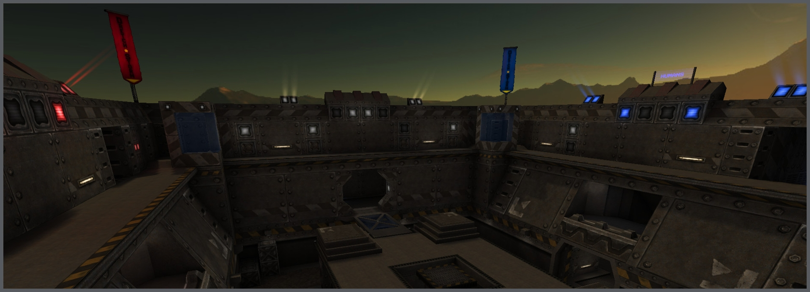

## Table of Contents
- [Introduction](#introduction)
- [Screenshots](#screenshots)
- [Version History](#version-history)
- [Setup Source](#setup-source)
  - [Build](#build)
  - [Run](#run)
- [Development Tools](#development-tools)
- [Related Resources](#related-resources)
- [Credits & License](#credits--license)
- [Acknowledgments](#acknowledgments)

## Introduction
Fort5 DS is a game level for the open source game [Tremulous](https://github.com/darklegion/tremulous/). Built from scratch, the map features a Fort5-like layout. It also includes a new texture set ([mas02](https://github.com/Masmblr/mas02-Texture-Set)) that improves the visuals. 

## Screenshots
<p align="left">
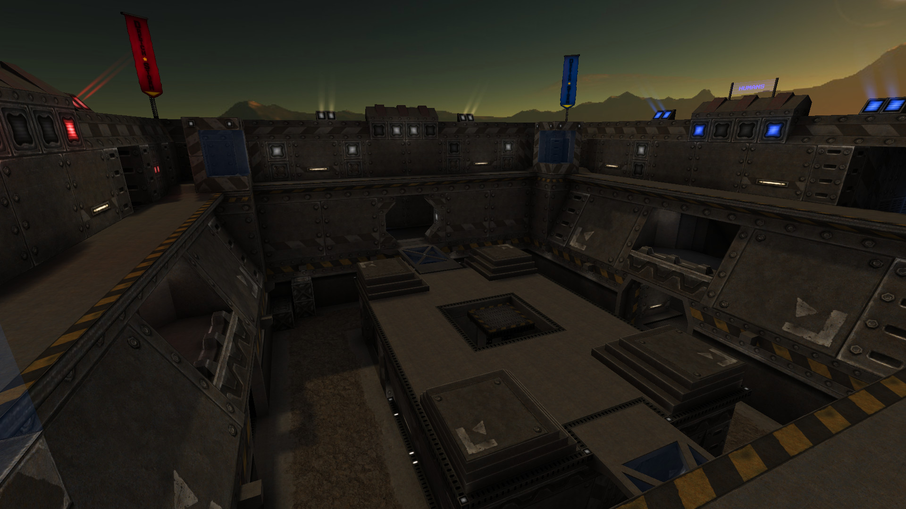
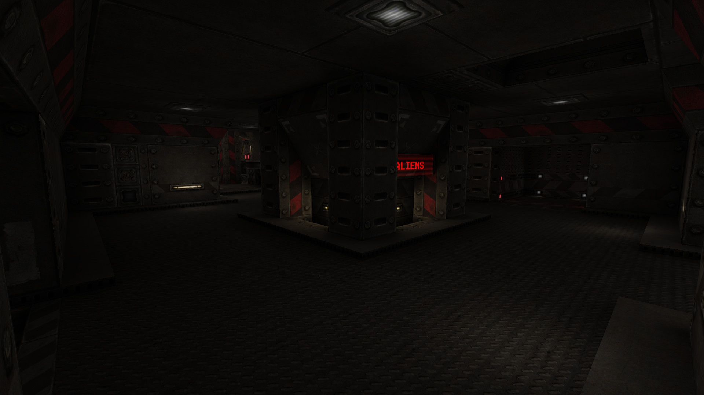
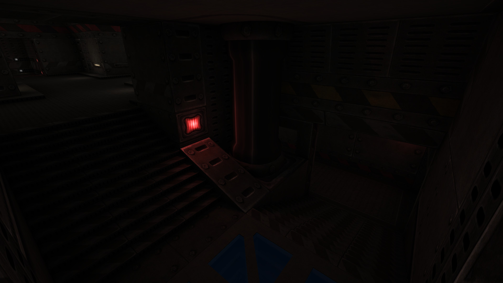
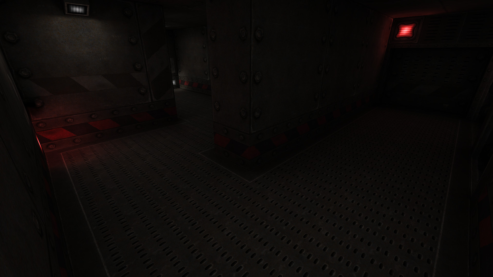
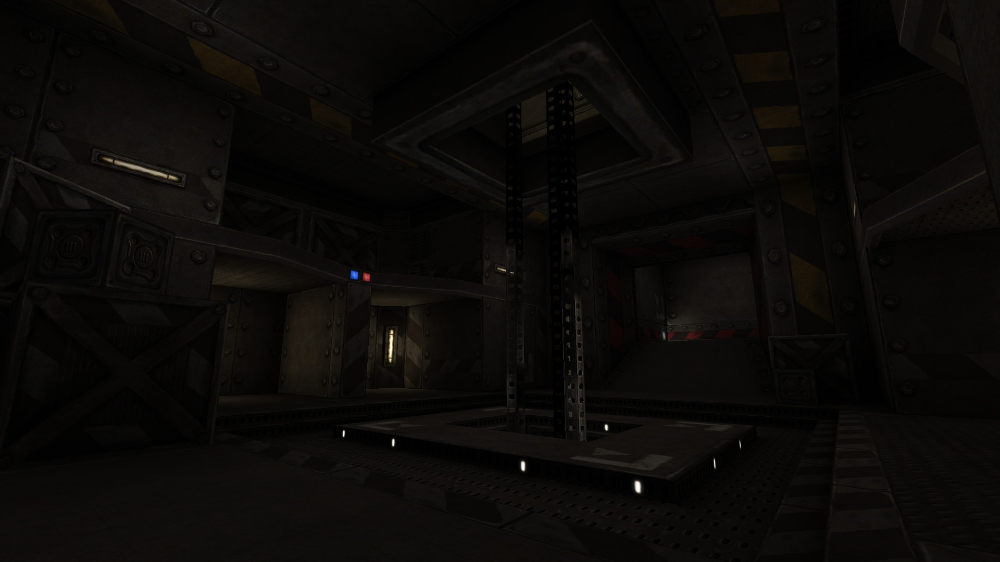
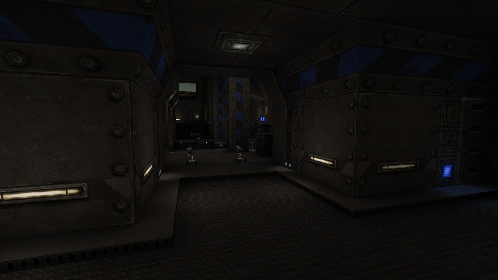
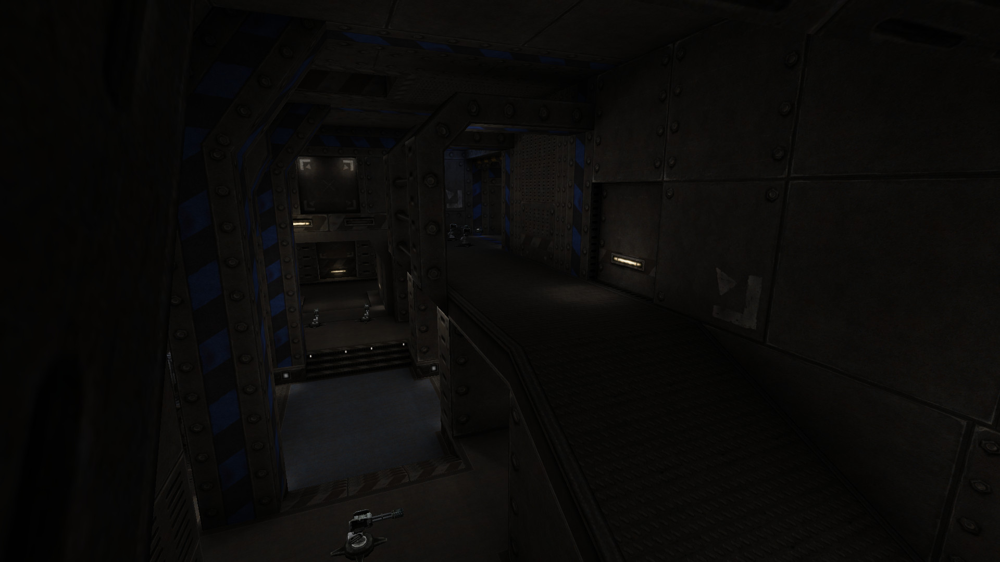
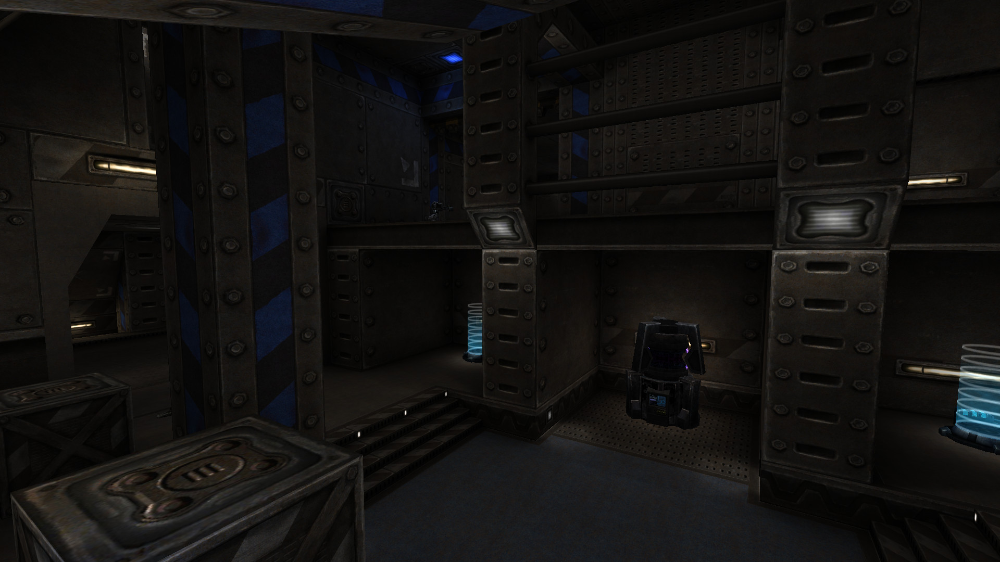
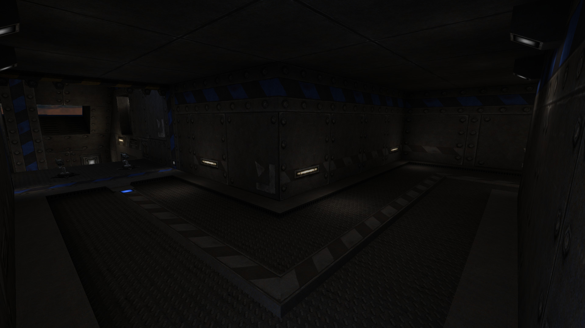
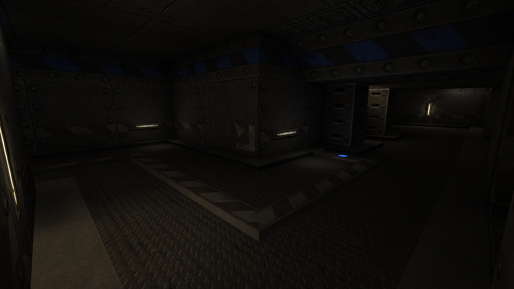
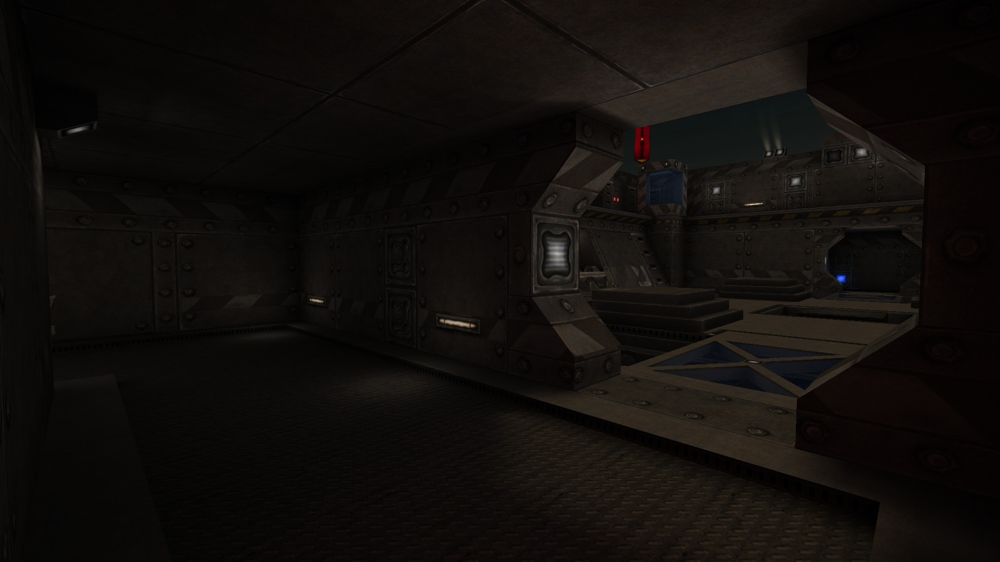

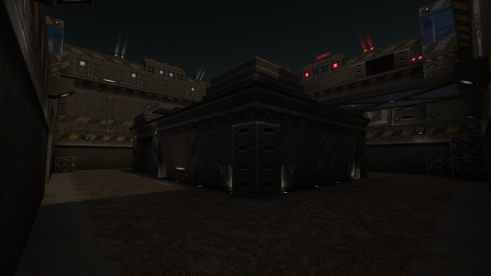
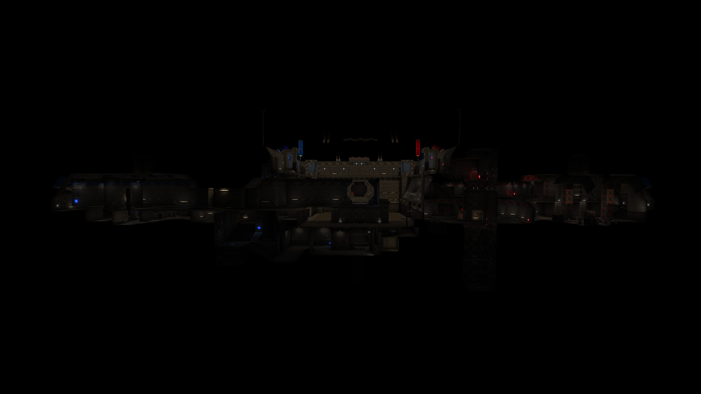
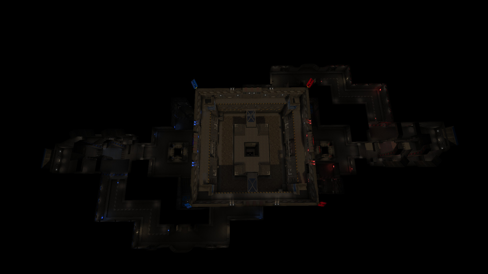

Comparison screenshots of the original DS Arena and this remake:</p>
  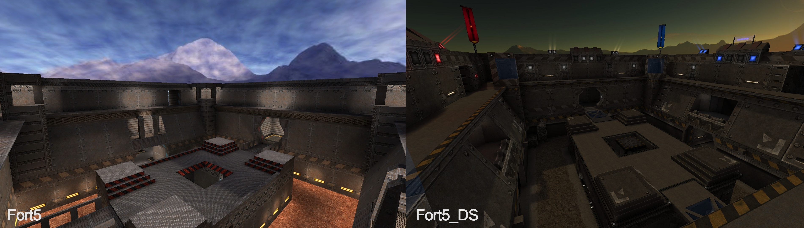
  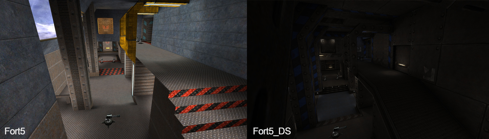
  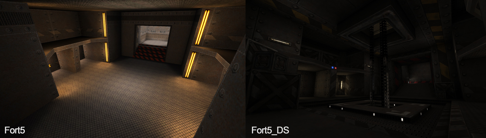

## Version History
| Version  | Date        | Status                | Files |
|----------|-------------|-----------------------|-----------|
| 0.1      | 2017/07/22  | alpha                 | – |
| 1.0      | 2017/08/23  | beta                  | – |
| 1.1      | 18/08/2023  | final               | – |
| 1.15     | 2025/10/26  | refactored (final)    | [map](https://github.com/Masmblr/map-fort5_ds_src/releases/latest) · [deps](https://github.com/Masmblr/mas02-Texture-Set/releases) |

## Setup Source

```console
# Clone with dependencies:
git clone --recurse-submodules https://github.com/Masmblr/map-fort5_ds_src.git
```

Run one of these scripts to merge the dependencies into the project structure:  
 
```console
# Linux / macOS
chmod +x merge_deps.sh
./merge_deps.sh  

# Windows PowerShell
Set-ExecutionPolicy -Scope Process -ExecutionPolicy Bypass
.\merge_deps.ps1
```  

Copy the contents of `src/` into your game base folder: `tremulous/base/`

### Build

If you want to compile the map yourself instead of using the prebuilt .pk3:

1. Install [NetRadiant](https://netradiant.gitlab.io/page/download/) with the **Tremulous** game profile.  
2. Open `fort5_ds.map` from `base/maps/`.	
3. Use **Build -> Build with final settings**. 

### Run

```console
# Linux / macOS
./tremulous-gpp.x86_64 -sv_pure 0 -devmap fort5_ds
```

```console
# Windows
tremulous-gpp.exe -sv_pure 0 -devmap fort5_ds
``` 

## Development Tools
- [GIMP](https://www.gimp.org/)  
- [Krita](https://krita.org/de/)  
- Photoshop CS6  
- [Audacity](https://www.audacityteam.org/)  
- [NetRadiant](https://netradiant.gitlab.io/)  
- [Q3Map2](http://q3map2.robotrenegade.com/)

## Related Resources
- [Official Tremulous Website](https://tremulous.net)  

## Credits & License
A comprehensive list of all files and their respective licenses can be found in the following document:
[→ LICENSE](LICENSE)

## Acknowledgments
- id Software for Quake3
- Dark Legion Development for Tremulous
- Team Xonotic for NetRadiant
